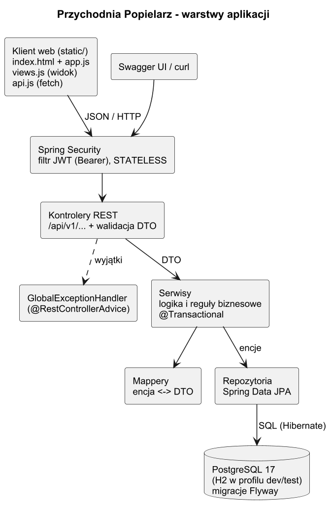
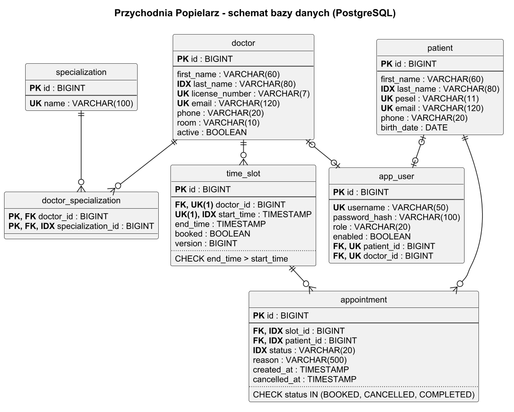
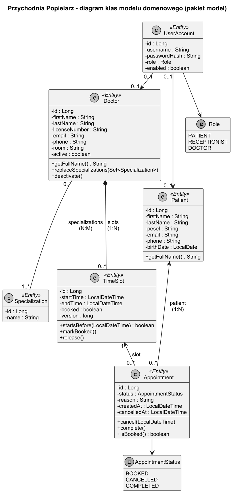
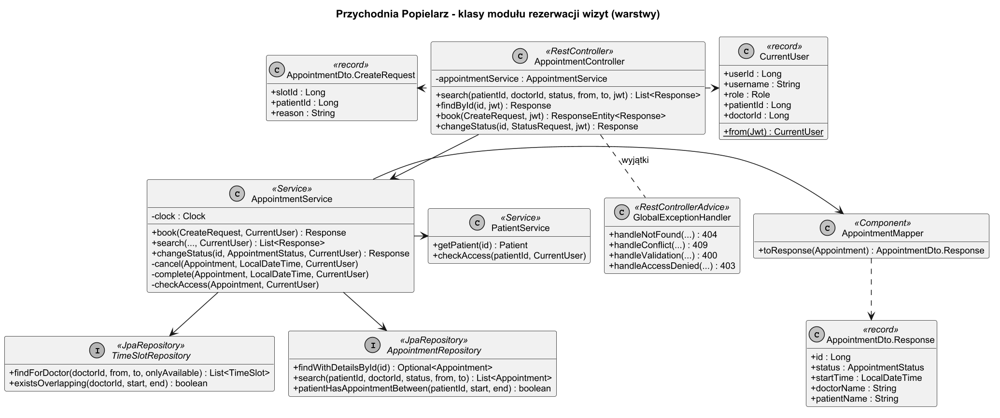

# Dokumentacja techniczna

## 1. Stos technologiczny

| Element | Wersja | Zastosowanie |
|---|---|---|
| Java | 21 (kompilacja `--release 21`, testowane na JDK 23) | język projektu |
| Spring Boot | 3.5.16 | konfiguracja aplikacji, serwer Tomcat |
| Spring Web MVC | 6.2 | kontrolery REST |
| Spring Data JPA + Hibernate | 3.5 / 6.6 | dostęp do bazy, repozytoria |
| Spring Security + OAuth2 Resource Server | 6.5 | bezstanowe uwierzytelnianie JWT, role |
| Bean Validation (Hibernate Validator) | 8.0 | walidacja DTO |
| PostgreSQL | 17 (obraz `postgres:17-alpine`) | docelowa baza danych |
| H2 | 2.3 | baza w pamięci dla profilu `dev` i testów |
| Flyway | 11 | wersjonowane migracje schematu i dane demo |
| springdoc-openapi | 2.10.0 | dokumentacja OpenAPI 3.1 i Swagger UI |
| JUnit 5, Mockito, MockMvc, AssertJ | (spring-boot-starter-test) | testy jednostkowe i integracyjne |
| Maven Wrapper | Maven 3.9.16 | budowanie bez instalowania Mavena |
| Docker Compose | – | uruchomienie bazy PostgreSQL |
| HTML5, CSS, JavaScript (moduły ES, `fetch`) | – | warstwa kliencka bez frameworka i bez kroku budowania |

## 2. Architektura

Aplikacja ma klasyczny podział warstwowy, każda warstwa w osobnym pakiecie `pl.popielarz.rejestracja`:

| Pakiet | Odpowiedzialność |
|---|---|
| `controller` | kontrolery REST – mapowanie URL i metod HTTP, walidacja wejścia (`@Valid`), kody odpowiedzi, nagłówek `Location` |
| `dto` | rekordy żądań i odpowiedzi API (`DoctorDto.Request/Response` itd.), encje nigdy nie wychodzą poza serwisy |
| `mapper` | zamiana encja ↔ DTO |
| `service` | logika biznesowa i reguły (rezerwacja, anulowanie, uprawnienia do danych), transakcje |
| `repository` | interfejsy Spring Data JPA z zapytaniami JPQL |
| `model` | encje JPA i typy wyliczeniowe |
| `exception` | wyjątki domenowe i `GlobalExceptionHandler` (`@RestControllerAdvice`) |
| `security` | obsługa tokenów JWT, `CurrentUser`, odpowiedzi 401/403 |
| `config` | konfiguracja Spring Security, OpenAPI, zegara (`Clock`) |
| `db.migration` | migracja Flyway w Javie generująca grafik demo |

Kontroler nie zna repozytoriów, a serwis nie zna HTTP – dostaje DTO i obiekt `CurrentUser` odczytany z tokena.
Zegar (`java.time.Clock`) jest wstrzykiwany, dzięki czemu testy reguł czasowych (termin miniony, wizyta rozpoczęta) są powtarzalne.

## 3. Baza danych

Oznaczenia: **PK** – klucz główny, **FK** – klucz obcy, **UK** – ograniczenie unikalności (w PostgreSQL realizowane indeksem unikalnym),
**IDX** – dodatkowy indeks, `UK(1)` – unikalność złożona z kilku kolumn.

| Tabela | Klucze i indeksy | Opis |
|---|---|---|
| `specialization` | PK `id`, UK `name` | słownik specjalizacji |
| `doctor` | PK `id`, UK `license_number`, UK `email`, IDX `last_name` | lekarze; `active = false` oznacza lekarza wycofanego (historia wizyt zostaje) |
| `doctor_specialization` | PK (`doctor_id`, `specialization_id`), FK do `doctor` i `specialization`, IDX `specialization_id` | tabela łącząca relacji **N:M** lekarz – specjalizacja |
| `time_slot` | PK `id`, FK `doctor_id`, UK (`doctor_id`, `start_time`), IDX `start_time`, CHECK `end_time > start_time` | terminy przyjęć, relacja **1:N** lekarz – terminy; `version` do optimistic locking |
| `patient` | PK `id`, UK `pesel`, UK `email`, IDX `last_name` | kartoteka pacjentów |
| `appointment` | PK `id`, FK `slot_id`, FK `patient_id`, IDX `patient_id`, `slot_id`, `status`, CHECK statusu | wizyty, relacje **1:N** pacjent – wizyty i termin – wizyty (anulowane wizyty zostają w historii) |
| `app_user` | PK `id`, UK `username`, FK + UK `patient_id`, FK + UK `doctor_id`, CHECK roli | konta logowania, relacja **1:1** z pacjentem albo lekarzem |

Schemat tworzą migracje Flyway w `src/main/resources/db/migration`:

* `V1__schema.sql` – tabele, klucze, indeksy, ograniczenia CHECK,
* `V2__demo_data.sql` – specjalizacje, 6 lekarzy, 4 pacjentów (m.in. Mateusz Popielarz), 5 kont,
* `V3__Demo_time_slots.java` – grafik od tygodnia wstecz do dwóch tygodni naprzód względem dnia uruchomienia i przykładowe wizyty.

Hibernate działa w trybie `ddl-auto: validate`, więc przy starcie sprawdza zgodność encji ze schematem z migracji.

### Reguła „brak podwójnej rezerwacji”

1. Serwis sprawdza flagę `time_slot.booked` i zwraca `409`, jeśli termin jest zajęty.
2. Rezerwacja ustawia `booked = true` w tej samej transakcji, w której zapisuje wizytę.
3. Gdy dwie transakcje wystartują równocześnie, kolumna `version` (`@Version`) powoduje, że druga z nich kończy się
   `ObjectOptimisticLockingFailureException`, który `GlobalExceptionHandler` zamienia na `409 Conflict`.
4. Dodatkowo pacjent nie może mieć dwóch aktywnych wizyt nachodzących na siebie w czasie.

## 4. Diagramy klas

Model domenowy (encje JPA, 6 klas + 2 typy wyliczeniowe):

Klasy modułu rezerwacji wizyt w kolejnych warstwach:

Źródła diagramów (PlantUML) są w katalogu `docs/diagramy/*.puml`.

## 5. Bezpieczeństwo i bezstanowość

* `POST /api/v1/auth/login` sprawdza login i hasło (BCrypt) i zwraca token JWT podpisany HMAC-SHA256.
  Token zawiera `sub` (login), `role`, `uid`, `patientId` albo `doctorId`, `iss` i czas ważności (8 godzin).
* Każde kolejne żądanie przesyła token w nagłówku `Authorization: Bearer <token>`. Serwer nie tworzy sesji
  (`SessionCreationPolicy.STATELESS`) i nie wysyła ciasteczek – całą informację o użytkowniku odczytuje z tokena.
* Klucz podpisu ustawia się zmienną środowiskową `JWT_SECRET` (w repozytorium jest tylko klucz deweloperski).
* Uprawnienia: role sprawdza `@PreAuthorize`, a właściciela danych (pacjent widzi tylko swoje wizyty) – serwisy.

## 6. Warstwa kliencka

Klient to statyczna strona w `src/main/resources/static`, serwowana przez tę samą aplikację:

| Plik | Rola |
|---|---|
| `index.html` | struktura strony: logowanie, zakładki „Lekarze i terminy” oraz „Moje wizyty” |
| `css/style.css` | wygląd |
| `js/api.js` | **logika komunikacji** – wszystkie wywołania `fetch` do `/api/v1`, dołączanie tokena, zamiana błędów HTTP na `ApiError`; nie dotyka DOM |
| `js/views.js` | **widok** – budowanie tabel, listy terminów, formularza, komunikatów; nie wywołuje API |
| `js/app.js` | kontroler – stan (wybrany lekarz, termin, użytkownik), obsługa zdarzeń, łączy `api.js` z `views.js` |

Taki podział (model/komunikacja – widok – kontroler) pozwala zmienić wygląd bez ruszania wywołań API
i odwrotnie. Zrezygnowano z frameworka (React itp.), bo przy kilku widokach nie jest potrzebny,
a strona działa bez instalowania Node.js i bez kroku budowania. Token jest trzymany w `sessionStorage`
przeglądarki, więc po zamknięciu karty trzeba zalogować się ponownie.

## 7. Testy

| Klasa | Rodzaj | Liczba testów | Co sprawdza |
|---|---|---|---|
| `AppointmentServiceTest` | jednostkowy (JUnit 5 + Mockito) | 11 | rezerwacja, zajęty/miniony termin, kolizja wizyt, 404, role, anulowanie, zakończenie wizyty, zawężanie wyszukiwania |
| `TimeSlotServiceTest` | jednostkowy | 5 | dodanie terminu, błędne godziny (400), nakładanie (409), grafik innego lekarza (403), usuwanie zajętego terminu |
| `DoctorServiceTest` | jednostkowy | 5 | relacja N:M ze specjalizacjami, unikalny PWZ, nieznana specjalizacja, wycofanie lekarza z wizytami, 404 |
| `DoctorControllerTest` | `@WebMvcTest` + MockMvc | 6 | kody 200/201/204/400/401/403/404, format `ErrorResponse`, nagłówek `Location` |
| `AppointmentControllerTest` | `@WebMvcTest` + MockMvc | 5 | 201 + `Location`, 409, 400, 401 bez sesji, PATCH anulowania |
| `BookingFlowIntegrationTest` | `@SpringBootTest` na H2 + Flyway | 2 | pełny scenariusz: logowanie, rezerwacja, druga rezerwacja → 409, anulowanie zwalnia termin; 401 i 403 |

Uruchomienie: `./mvnw test` (Windows: `mvnw.cmd test`). Testy nie wymagają Dockera.
